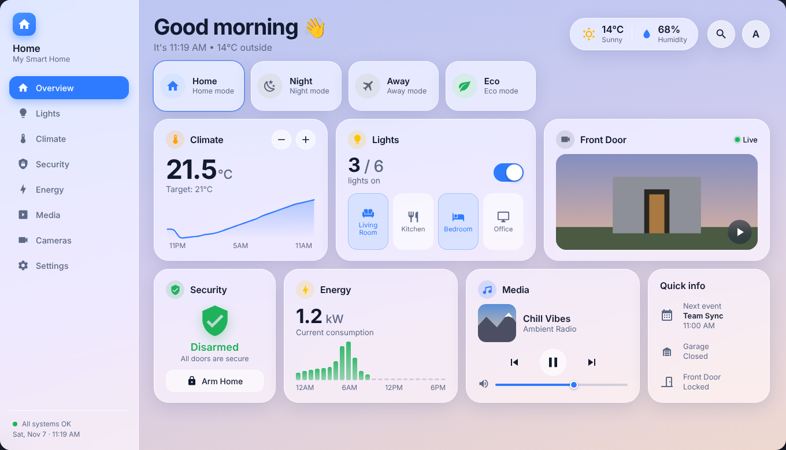

# Glass Home Dashboard

Apple-style **glass** dashboard for Home Assistant, built as configurable Lovelace custom cards.
Every card reads **your** entities — nothing is hard-coded. Responsive (desktop · tablet · phone),
light/dark, English & French.



> 🇫🇷 Version française : [README.fr.md](README.fr.md)

## Cards

`glass-layout-card` (page) · `glass-sidebar-card` · `glass-header-card` · `glass-modes-card` ·
`glass-climate-card` · `glass-lights-card` · `glass-camera-card` · `glass-security-card` ·
`glass-energy-card` · `glass-media-card` · `glass-quick-info-card`

Each one works standalone in any view; the layout card assembles them into the full dashboard.
Options: [docs/CARDS.md](docs/CARDS.md).

## Install

**HACS** (custom repository → category _Dashboard_): add this repository, install, reload.
Manual install and store submission: [docs/PUBLISHING.md](docs/PUBLISHING.md).

## Set up the dashboard

1. Settings → Dashboards → _Add dashboard_, open it, ⋮ → _Edit_ → ⋮ → **Raw configuration editor**.
2. Paste [`examples/dashboard.yaml`](examples/dashboard.yaml).
3. Replace the entity ids with yours (climate, lights, camera, alarm, power sensor, media player, calendar…).
4. Optional: put a photo in `/config/www/glass-home/house.jpg` and set `background: /local/glass-home/house.jpg`.

Minimal standalone usage:

```yaml
type: custom:glass-climate-card
entity: climate.living_room
```

The cards also have a visual editor in the card picker.

## Develop

```bash
npm ci
npm run dev      # preview with a mock Home Assistant (desktop/tablet/phone), http://localhost:5173/dev/
npm run check    # typecheck + tests + format + build
```

Humans and AI agents: start with [AGENTS.md](AGENTS.md) and [docs/ARCHITECTURE.md](docs/ARCHITECTURE.md).
Theming: [docs/THEMING.md](docs/THEMING.md). Adding a card: [docs/ADD-A-CARD.md](docs/ADD-A-CARD.md).

## License

MIT
